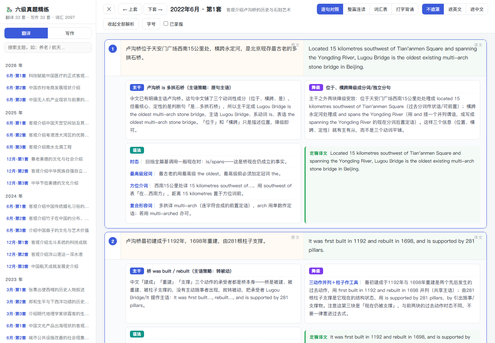
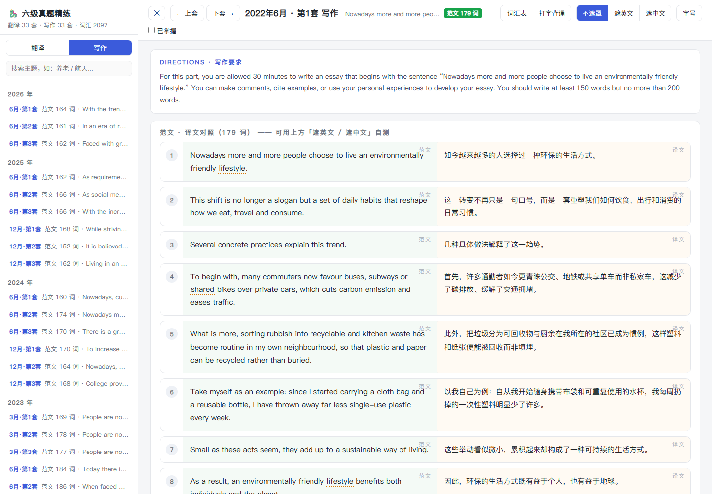
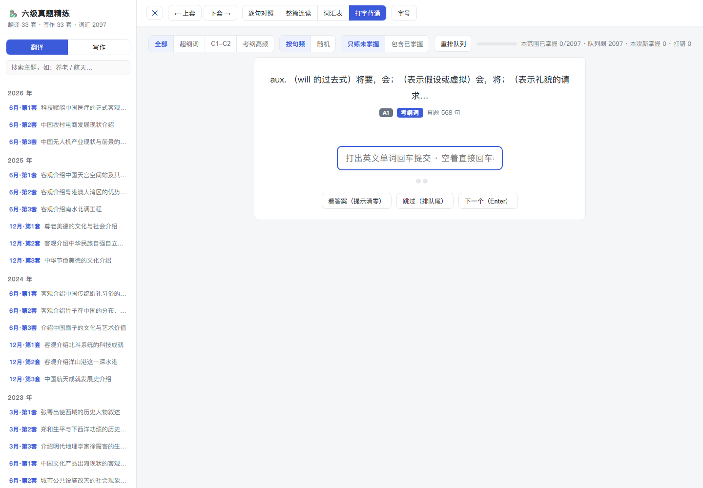
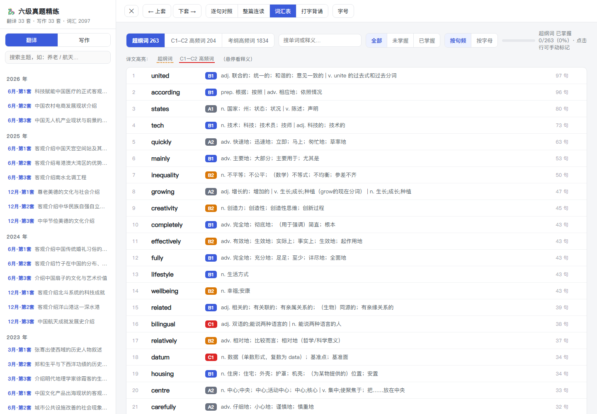
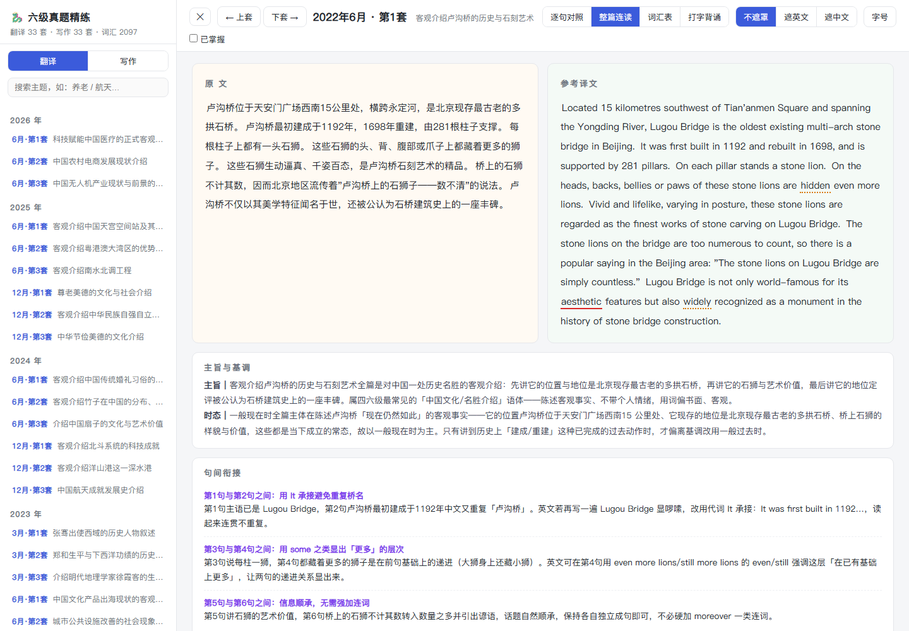

# 🐉 六级真题精练

**一个 HTML 文件的六级备考全套**——双击打开就能用，不联网、不装环境、不注册账号。

[](#) [](#) [](#) [](#)

---

## 它长这样

**翻译 · 逐句对照** —— 中文一句、英文一句，永远不用再回头找"这句话在译文里是哪句"。点任何一行展开解析：句子主干、修饰降级、语法点、定稿译文。



**写作 · 范文对照** —— 33 套真题范文逐句对中文译文，配逐段拆解、审题立意、能直接套的填空句架（`Just as ＿＿ cannot ＿＿ without ＿＿…`），外加低分写法避坑。



**打字背诵** —— 只给你中文释义，把单词打出来。**连续两次无提示打对才算掌握**；打错了排队尾再来，空回车直接跳下一个。2097 个词（超纲词 263 + C1–C2 高频 204 + 考纲高频 1834，去重合并）全靠手感记。



**词汇表 + 整篇连读** —— 词表按句频排序、CEFR 等级标色、点击标记掌握；整篇模式下悬停任何一句，中英两侧同时高亮。

| 词汇表 | 整篇连读 |
|---|---|
|  |  |

## 几个贴心的小设计

- 🔖 **遮罩自测**：遮住英文（或中文），点对应半区单独揭示那一句——翻译和写作都能这么练
- 🔍 **生词自动高亮**：范文和译文里，超纲词画橙点线、C1–C2 高频词画红线，悬停即看释义，读着读着就把词背了
- 📊 **进度本地留存**：掌握记录、套题完成度全存浏览器 localStorage，下次打开接着来；侧栏 ☰ 可收起，←/→ 键切套
- 🔗 **URL 直达**：`?sec=w&mode=type` 打开即写作板块打字背诵，`?blur=en` 打开即遮英文自测

## 用起来

```bash
git clone https://github.com/lii-lii321/cet6-exam-review.git
```

然后双击 `六级翻译逐句对照.html`。完了，就这么简单。

## 想改内容？全套构建链都在

```
.workbuddy/cet6_build/
├── template.html        # 网页模板（样式/交互/占位符）
├── build.py             # 构建：注入 JSON → 成品 HTML
├── parse_cet6.py        # 翻译 PDF 解析 → data.json（180 句）
├── parse_writing.py     # 写作 PDF 解析 → writing.json
├── parse_vocab.py       # 词表解析 + 三表去重 → vocab.json
├── screenshot.py        # Edge headless 批量截图（README 配图）
├── smoke.js             # 冒烟测试（node smoke.js 即可跑）
└── extracted*/          # 66 套 PDF 提取的中间 markdown
```

换一批新真题：PDF 提取成 markdown → 丢进 `extracted*/` → 跑三个 parse 脚本 → `build.py` → 新的成品 HTML 就出来了。

> 📄 PDF 原件不入库（`.gitignore` 已排除），复现提取请自备同源 PDF。

## 免责声明

仅供个人学习备考。真题为公开考试内容；题目解析整理自[懒笔记](https://english-exam.lazynote.cn/)。若内容涉及侵权请联系仓库所有者删除，请勿用于任何商业用途。
